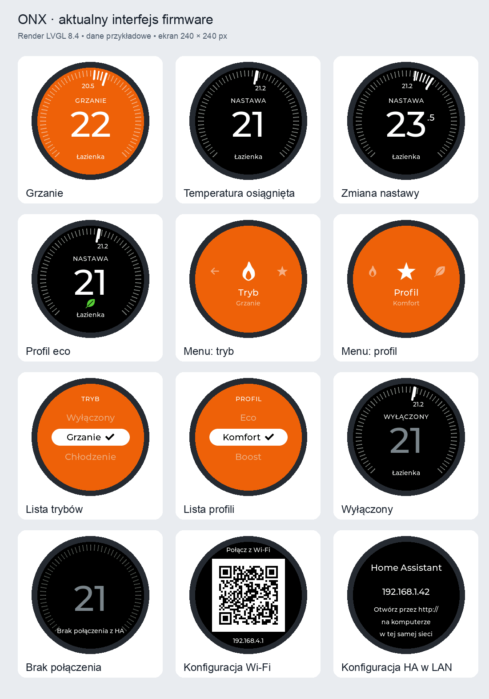

# ONX Thermostat. Pokrętło Open Nextion jako panel termostatu Home Assistant

Firmware zamienia okrągły wyświetlacz z pokrętłem **Open Nextion ONX2424G013**
w ścienny panel do jednego termostatu z Home Assistant. Obracasz pierścień, żeby
zmienić temperaturę. Klikasz, żeby zmienić tryb albo profil. Ekran przypomina
termostat Nest: kolor tła mówi, czy dom się grzeje, a kreski na obwodzie
pokazują, ile brakuje do nastawy.

Panel niczego nie reguluje sam. Algorytm ogrzewania zostaje w Home Assistant,
a panel jest jego wygodnym pilotem.



Ekrany to rendery z LVGL na przykładowych danych, a nie zdjęcia urządzenia.

## Z czym współpracuje

**Sprzęt.** Open Nextion ONX2424G013: ESP32-S3 (16 MB flash, 8 MB PSRAM),
okrągły ekran GC9A01 1,28" 240×240, pierścień-enkoder z przyciskiem.
Inne płytki wymagają zmian w `include/BoardConfig.h`.

**Home Assistant.** Panel łączy się z HA przez API WebSocket i steruje jedną
encją `climate`. Potrzebujesz HA w wersji 2022.4 lub nowszej oraz tokenu
długoterminowego z profilu użytkownika. Nie trzeba instalować żadnej integracji,
dodatku ani ESPHome.

**Termostaty w HA.** Panel używa wyłącznie standardowych usług
`climate.set_temperature`, `climate.set_hvac_mode` i `climate.set_preset_mode`,
więc działa z każdą encją `climate` z jedną temperaturą zadaną. W szczególności:

- [Better Thermostat](https://github.com/KartoffelToby/better_thermostat),
- [Versatile Thermostat](https://github.com/jmcollin78/versatile_thermostat)
  (VTherm), łącznie z jego profilami i atrybutem `target_temperature_step`,
- termostaty z innych integracji (głowice, klimatyzatory, pompy ciepła), jeśli
  udostępniają encję `climate`.

Zakres, krok, tryby i profile panel bierze z encji. Nic nie jest wpisane na
sztywno.

## Co potrafi

- **Nastawa pokrętłem.** Jedna zapadka to jeden krok encji (zwykle 0,5 °C).
  Panel wysyła nastawę do HA 650 ms po ostatnim ruchu.
- **Ekran w stylu Nest.** Tło jest pomarańczowe, gdy grzeje, niebieskie, gdy
  chłodzi, i czarne w spoczynku. Na obwodzie jedna kreska przypada na jeden
  krok. Rozjaśniony odcinek łączy temperaturę w pokoju z nastawą. Zielony listek
  oznacza profil eco.
- **Menu dwupoziomowe.** Klik otwiera rząd ikon: Wróć, Tryb, Profil i Eco.
  Klik na Tryb albo Profil pokazuje listę opcji z encji. Obrót tylko przesuwa
  zaznaczenie, polecenie wysyła dopiero klik.
- **Uczciwe dane.** Brak pomiaru panel pokazuje jako `--`. Po utracie połączenia
  wyszarza ekran i nie powtarza starych poleceń.
- **Przyciemnianie.** Po 30 s bez ruchu ekran przygasa do 20%. Pierwszy ruch
  pokrętłem tylko go budzi.
- **Konfiguracja bez kompilacji.** Wi-Fi ustawiasz z telefonu, a połączenie z HA
  z przeglądarki na komputerze. Ustawienia są zapisane w pamięci panelu.
- **Aktualizacja przez sieć.** Nowy firmware wgrasz ze strony konfiguracji.
  Jeśli nowa wersja się nie uruchomi, panel wróci do poprzedniej.
- **Polski interfejs.** Napisy na ekranie i strona konfiguracji są po polsku,
  razem z polskimi znakami.

## Jak zbudować i wgrać firmware

Projekt używa czystego **ESP-IDF 5.3** (C++17, LVGL 8.4). Nie potrzebujesz
Arduino ani PlatformIO.

1. Zainstaluj ESP-IDF 5.3 według
   [instrukcji Espressif](https://docs.espressif.com/projects/esp-idf/en/v5.3/esp32s3/get-started/).
2. Pobierz repozytorium i przejdź do jego katalogu.
3. Wczytaj środowisko ESP-IDF:
   ```sh
   . ~/esp/esp-idf/export.sh
   ```
4. Zbuduj firmware. Przy pierwszym budowaniu ESP-IDF pobierze komponenty
   (LVGL, sterownik GC9A01, klienta WebSocket) w wersjach z `dependencies.lock`.
   ```sh
   idf.py set-target esp32s3
   idf.py build
   ```
5. Podłącz panel kablem USB-C i wgraj firmware. Nazwę portu sprawdzisz
   poleceniem `ls /dev/cu.usb*` (macOS) albo `ls /dev/ttyACM*` (Linux).
   ```sh
   idf.py -p /dev/cu.usbmodemXXXX flash monitor
   ```

Pierwsze wgranie musi przejść przez USB, bo zapisuje bootloader i tablicę
partycji. Kolejne wersje możesz wgrywać przez sieć.

## Pierwsze uruchomienie

Konfiguracja ma dwa etapy. Wi-Fi ustawiasz z telefonu, Home Assistant z komputera,
bo wklejanie długiego tokenu na telefonie jest niewygodne.

### Krok 1. Wi-Fi z telefonu

1. Zeskanuj kod QR z ekranu panelu i połącz się z jego siecią (`ONX-XXXX`).
2. Otwórz w przeglądarce `http://192.168.4.1`.
3. Wpisz nazwę i hasło domowej sieci 2,4 GHz, a potem zapisz.
4. Panel uruchomi się ponownie i pokaże adres IP z domowej sieci. Wróć telefonem
   do domowego Wi-Fi.

Jeśli panel nie połączy się z siecią w ciągu 30 s, znowu pokaże kod QR. Możesz
wtedy poprawić nazwę albo hasło.

### Krok 2. Home Assistant z komputera

1. Na komputerze w tej samej sieci otwórz `http://ADRES_IP_PANELU`.
2. Wpisz adres HA, np. `http://homeassistant.local:8123`.
3. Wklej token długoterminowy. Utworzysz go w HA w profilu użytkownika,
   na karcie bezpieczeństwa (*Long-lived access tokens*).
4. Zapisz i po restarcie panelu odśwież stronę.
5. Kliknij **Pobierz termostaty z HA** i wybierz encję, np. Better Thermostat
   albo Versatile Thermostat dla danego pokoju.
6. Kliknij **Zakończ konfigurację**. Panel uruchomi termostat i zamknie stronę
   konfiguracji.

## Obsługa

| Ruch | Ekran termostatu | Menu |
|---|---|---|
| Obrót | zmienia nastawę o jeden krok na zapadkę | przesuwa zaznaczenie |
| Klik | otwiera menu | wybiera pozycję |
| Przytrzymanie 3 s | otwiera konfigurację | otwiera konfigurację |

Menu zamyka się samo po 15 s bez ruchu. Po sekundzie przytrzymania ekran
podpowiada, że trzymasz pokrętło po konfigurację.

**Eco** w menu działa jak przełącznik. Gdy profil eco jest wyłączony, klik go
włącza. Gdy jest włączony, przełącza na profil `none`. Pozycja Eco pojawia się
tylko wtedy, gdy encja ma profil `eco`.

### Jak zmienić ustawienia później

1. Przytrzymaj pokrętło przez 3 s.
2. Otwórz na komputerze adres, który pokaże panel.
3. Zmień, co trzeba. Przycisk **Zmień sieć Wi-Fi** zachowuje ustawienia HA,
   ale hasło do Wi-Fi trzeba wpisać ponownie. Puste pole tokenu zachowuje
   zapisany token. Zmiana adresu HA kasuje wybór encji.

## Aktualizacja przez sieć (OTA)

1. Podnieś `PROJECT_VER` w `CMakeLists.txt` i zbuduj firmware (`idf.py build`).
2. Przytrzymaj pokrętło przez 3 s i otwórz stronę konfiguracji.
3. W sekcji **Aktualizacja firmware** wybierz plik `build/onx_thermostat_panel.bin`.

Panel sprawdza sumę kontrolną, typ układu i nazwę projektu, a potem zapisuje
obraz na wolnej partycji. Nowa wersja zostaje na stałe po 15 s poprawnej pracy
albo gdy wejdziesz do konfiguracji. Jeśli zrestartuje się wcześniej, bootloader
przywróci poprzednią.

## Ograniczenia i bezpieczeństwo

To wczesna wersja dla osób, które same kompilują firmware, a nie gotowy produkt.
Co sprawdzono na urządzeniu, a co czeka na test, opisuje
[`docs/hardware-validation.md`](docs/hardware-validation.md).

- `ws://` nie szyfruje tokenu ani danych. Używaj go tylko w zaufanej sieci lokalnej.
- `wss://` sprawdza certyfikat pakietem CA z ESP-IDF. Certyfikaty samopodpisane
  i własne CA nie są obsługiwane.
- Strona konfiguracji działa po HTTP, także przy wpisywaniu tokenu. Jest
  dostępna tylko podczas pierwszej konfiguracji i po przytrzymaniu pokrętła.
  Przyjmuje wyłącznie adres IP widoczny na ekranie. API nie zwraca zapisanych
  haseł ani tokenu.
- Pamięć ustawień (NVS) nie jest szyfrowana, a obrazy OTA nie są podpisane.
- Encji z dwiema nastawami (`target_temp_low/high`) nie wyregulujesz pokrętłem.
  Tryb i profil zmienisz z menu, ale edycji zakresu jeszcze nie ma.
- Lista encji pokazuje wszystkie encje `climate`. Panel nie rozpoznaje, z której
  integracji pochodzą.
- Pełną listę stanów HA panel pobiera tylko w konfiguracji i przyjmuje do 1 MiB.
  Bardzo duże instalacje mogą ten limit przekroczyć.
- Ekran wyświetla litery łacińskie i polskie. Inne znaki w nazwach encji pominie.
- Panel nie ma jeszcze własnego czujnika temperatury. Nie udaje go też
  temperaturą procesora.

## Rozwiązywanie problemów

**Panel ma adres IP, ale nie łączy się z HA.** Sprawdź z komputera, czy HA
odpowiada pod adresem z konfiguracji. Jeśli tak, a panel był wiele razy
resetowany (np. przy wgrywaniu przez USB), router mógł zachować starą sesję
Wi-Fi panelu i nie przekazywać mu ruchu. Pomaga restart routera albo usunięcie
panelu z listy klientów. Programowe restarty panelu najpierw rozłączają Wi-Fi,
żeby tego uniknąć.

**Logi.** `idf.py -p PORT monitor` pokazuje komunikaty Wi-Fi i klienta WebSocket.

## Struktura projektu

| Ścieżka | Zawartość |
|---|---|
| `main/main.cpp` | start, enkoder, przycisk, menu, przyciemnianie |
| `main/display.cpp` | sterownik LCD i ekrany LVGL |
| `main/ha_client.cpp` | protokół WebSocket HA i stan termostatu |
| `main/config.cpp`, `main/portal.html` | Wi-Fi, pamięć ustawień, strona konfiguracji, OTA |
| `main/backlight.cpp` | PWM podświetlenia |
| `main/ui_assets.c` | fonty i ikony generowane przez `tools/assets/gen_ui_assets.py` |
| `include/` | logika bez zależności od sprzętu (model, menu, nazwy trybów) i pinout |
| `test/` | testy na komputerze |
| `tools/preview/` | render ekranów bez sprzętu |
| `docs/` | porównanie z dokumentacją producenta i lista testów na urządzeniu |

## Testy i podgląd ekranów

```sh
test/run.sh
```

Skrypt kompiluje testy z `test/` z flagami `-Wall -Wextra -Werror` i je
uruchamia. Na macOS sprawdza też skrypt strony konfiguracji przez JavaScriptCore.
Test `EntityTracker` potrzebuje biblioteki cJSON z ESP-IDF (`$IDF_PATH`).

```sh
python3 tools/preview/render.py
```

Renderuje ekrany z kodu `main/display.cpp` do `docs/screenshots/`. Potrzebuje
CMake, Ninja, Pillow i komponentów pobranych przy pierwszym `idf.py build`.
Po zmianie fontów albo ikon uruchom `python3 tools/assets/gen_ui_assets.py`.

## Linki

Producent urządzenia:
- [Wiki ONX2424G013](https://nextion.tech/wiki/onx2424g013/)
- [Repozytorium producenta na GitHubie](https://github.com/OpenNextion/OpenNextion-SKU-ONX2424G013):
  schematy, dokumentacja układów, przykłady ESP-IDF
- [Strona produktu w sklepie ITEAD](https://itead.cc/product/open-nextion-genius-series-1-28-esp32-s3-smart-knob-screen/)
- [ONX2424G013 w Open Nextion App Store](https://open-nextion-app-store.nextion.tech/devices/onx2424g013/)

Home Assistant i integracje:
- [API WebSocket Home Assistant](https://developers.home-assistant.io/docs/api/websocket/)
- [Better Thermostat](https://github.com/KartoffelToby/better_thermostat)
- [Versatile Thermostat](https://github.com/jmcollin78/versatile_thermostat)

## Licencja

Kod udostępniamy na licencji MIT (zob. [`LICENSE`](LICENSE)). Font Montserrat
w `main/ui_assets.c` pochodzi z LVGL i jest na licencji SIL Open Font License 1.1.
